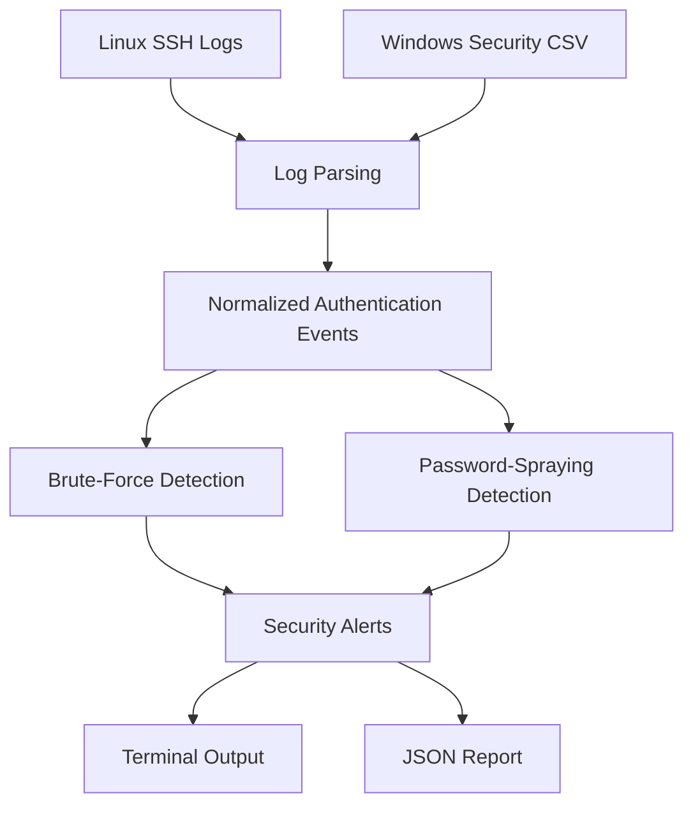

# Attack-and-Detect

A Python-based authentication log analyzer that detects potential brute-force attacks and password spraying in Linux SSH logs and Windows Security Event CSV files.

## Overview

I built Attack-and-Detect to get more hands-on experience with security monitoring, log analysis, and detection engineering.

The project focuses on two common authentication attacks: brute force, where repeated login attempts target the same account, and password spraying, where an attacker attempts to access multiple accounts.

The tool reads authentication logs, extracts failed login events, and applies time-based detection rules to identify suspicious patterns. It then generates alerts with information that would be useful during a security investigation.

I wanted to go beyond simply identifying failed logins, so I included configurable detection thresholds, JSON reporting, and automated tests to check that the detection logic works as expected.

## Features

- Parses Linux SSH authentication logs
- Processes Windows Security Event ID 4625 records from CSV files
- Detects potential brute-force attacks and password spraying
- Supports configurable detection thresholds and time windows
- Generates alerts with source IP addresses, affected accounts, and timestamps
- Includes recommended investigation actions
- Exports findings to JSON
- Handles malformed log entries without stopping the entire analysis
- Includes 17 automated unit tests

## How It Works

The tool supports two log formats:

**Linux:** SSH authentication logs containing failed password attempts.

**Windows:** CSV files containing Windows Security Event ID 4625 (failed logon) records.

The parsers extract the relevant information and convert it into a consistent event structure containing the source IP address, username, and timestamp.

These events are passed to two detection functions.

### Brute-Force Detection

The tool groups failed login attempts by source IP address and username.

An alert is generated when the number of failed attempts reaches the configured threshold within the specified time window.

Default settings:
- 3 failed login attempts
- 60-second time window

### Password-Spraying Detection

The tool groups authentication failures by source IP address and checks how many different accounts were targeted within a specified time window.

Default settings:
- 3 unique accounts
- 120-second time window

Both detection rules can be adjusted when running the tool.

## Project Architecture



## Requirements

- Python 3.9 or later
- No external Python packages required

## Running the Tool

Clone the repository:

```bash
git clone https://github.com/amaraaustin/attack-detect-log-analyzer.git
cd attack-detect-log-analyzer
```

Analyze a Linux authentication log:

```bash
python3 analyzer.py --file sample_auth.log --format linux
```

Analyze Windows authentication events:

```bash
python3 analyzer.py --file windows_auth.csv --format windows
```

The Windows CSV should contain the following columns:

`EventID,TimeCreated,IpAddress,TargetUserName`

Adjust detection settings:

```bash
python3 analyzer.py --file sample_auth.log --format linux --brute-threshold 5 --brute-window 120 --spray-threshold 4 --spray-window 180
```

Generate a JSON report:

```bash
python3 analyzer.py --file sample_auth.log --format linux --output security_report.json
```

## Testing and Validation

I tested the tool using synthetic Linux and Windows authentication records, as well as real SSH authentication failures generated in an isolated Ubuntu lab.

I also created a clean log sample to confirm that the tool does not generate alerts when the detection thresholds are not met.

The project includes 17 automated tests covering:

- Brute-force and password-spraying detection
- Events that should not trigger alerts
- Detection time-window boundaries
- Custom thresholds
- Linux log parsing
- Alert information and JSON export
- Invalid command-line configuration

To run the tests:

```bash
python3 -m unittest discover -v
```

All 17 tests passed during local validation.

## Project Files

| File | Purpose |
|------|---------|
| `analyzer.py` | Linux log parsing, detection logic, and command-line interface |
| `windows_parser.py` | Windows Security Event CSV parsing |
| `reporter.py` | JSON report generation |
| `test_analyzer.py` | Automated tests |
| `sample_auth.log` | Sample Linux authentication events |
| `windows_auth.csv` | Sample Windows authentication events |
| `clean_auth.log` | Sample used to test non-detection |

## Limitations

This is a rule-based detection project, not a complete security monitoring platform.

It currently focuses on failed authentication attempts and does not correlate them with successful logins. This means an alert indicates potentially suspicious activity rather than confirming that an account has been compromised.

The Linux detection was tested against real lab-generated SSH activity, while the Windows parser was tested using synthetic CSV data.

Traditional Linux syslog timestamps without a year are interpreted using the current year, and timestamps without timezone information are assumed to be UTC. Malformed individual records are skipped, but the tool does not currently report how many were skipped.

The default thresholds are intended for demonstration and would need tuning for different environments to reduce false positives and missed detections.

## What I Learned

Working on this project gave me practical experience with Python log parsing, time-based detection rules, and security event analysis.

It also helped me understand why testing matters in detection engineering. A detection rule needs to identify suspicious behavior, but it also needs to avoid generating alerts for activity that does not meet the conditions.

The project gave me a better understanding of how authentication events can be analyzed and presented as actionable security findings.

## Future Improvements

Some areas I would like to explore further include correlating failed and successful logins, validating against real Windows Security Event exports, and integrating the generated alerts with a SIEM.

## Responsible Use

All authentication testing was performed in an isolated, authorized lab environment. The sample datasets included in this repository are synthetic.
